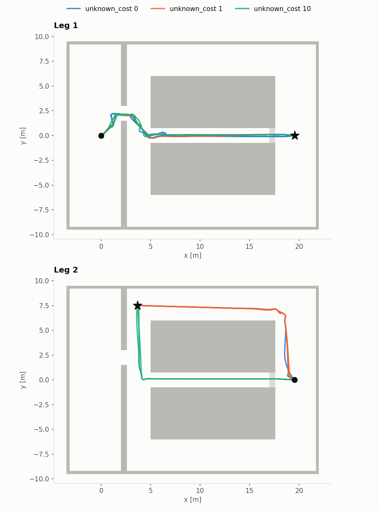
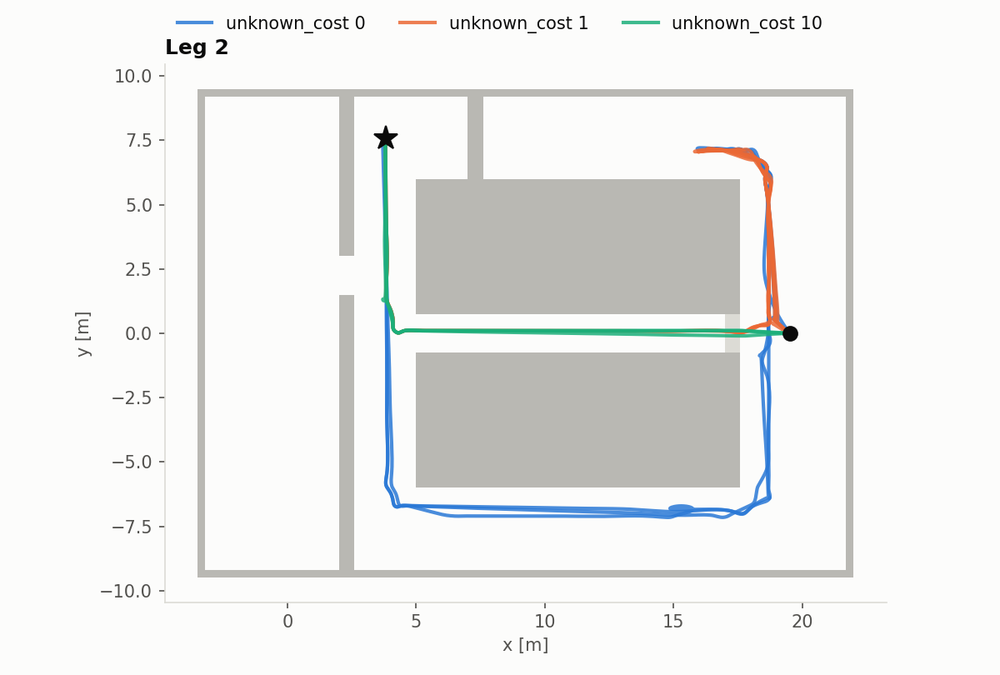
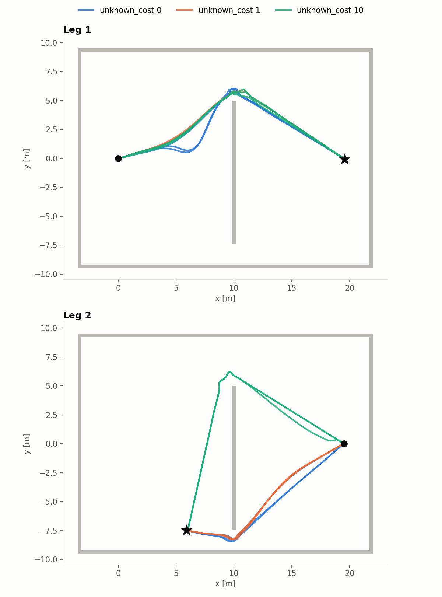

# 3D Planner for an Autonomous Drone

A from-scratch 3D path planner that lets a PX4 drone fly to a goal through a space it has
never seen: A* on a live OctoMap, a smoothed trajectory, and replanning as the map grows.
Simulation, flight control and mapping are off-the-shelf (Gazebo Harmonic, PX4 SITL, OctoMap).

Project page: https://nfrancinelli.github.io/projects/3d-planner/

## Status

- [x] Milestone 1 – infrastructure: Docker stack, PX4 offboard control, trajectory server flying a figure-eight
- [x] Milestone 2 – depth camera → OctoMap
- [x] Milestone 3 – A* with unknown-space cost, smoothing, collision check
  - [x] A* on the live OctoMap, obstacle inflation, cost for unknown space
  - [x] Path shortcutting and smooth trajectory, collision-checked against the map
  - [x] Trajectory server flies the planned trajectory
- [x] Milestone 4 – replanning in the factory world
  - [x] `factory` world: 1.5 m gaps, a corridor dead-ending at a crate wall
  - [x] New plans take over a trajectory in flight without a jump
  - [x] Replanning when the path gets blocked, switching to clearly shorter ways, braking when stuck
- [ ] Milestone 5 – unknown-cost comparison + demo video
  - [x] Unknown-cost comparison (see Unknown-space cost)
  - [ ] Demo video

## Quick start

Requires Docker (and the NVIDIA container toolkit for GPU rendering).

```bash
docker/build.sh                       # once; builds PX4 + px4_msgs, takes a while
docker/run.sh                         # shell inside the container, repo's ros2_ws mounted at /ws
colcon build --symlink-install && source install/setup.bash
ros2 launch drone_bringup sim.launch.py               # factory world, headless Gazebo + RViz
ros2 launch drone_bringup sim.launch.py gui:=true     # also open the Gazebo GUI (heavy)
ros2 launch drone_bringup sim.launch.py rviz:=false   # nothing on screen
ros2 launch drone_bringup sim.launch.py localization:=gps   # PX4's GPS/compass estimate
ros2 launch drone_bringup sim.launch.py world:=boxes figure_eight:=true  # fly a figure-eight, land
ros2 launch drone_bringup sim.launch.py show_free_space:=true  # also publish OctoMap free voxels
ros2 launch drone_bringup sim.launch.py real_time_factor:=0.5  # half speed, for a loaded host
```

Gazebo runs headless by default (sensors render offscreen on the GPU); RViz shows the drone,
the planned trajectory (coloured by speed), the flown trail (green) and the OctoMap built
from the depth camera. The default world is `factory`; pick another with `world:=<name>`.

`path_planner` and `trajectory_server` build in Release by default: unoptimized, planning
is about 25× slower and smoothing about 100× slower.

Run `colcon test && colcon test-result --verbose` for the unit tests.

Run `docker/run.sh` again from another terminal to attach a second shell to the same container.

## Flying to a goal

Launch the sim: the drone takes off and hovers (if PX4 hasn't climbed to within 0.5 m of
the takeoff altitude 10 s after the climb, the trajectory server logs "Takeoff failed" and
lands; PX4 occasionally arms, reports the takeoff and stays on the ground). Then use
**2D Goal Pose**
in the RViz toolbar to click a goal (flown at `goal_altitude`, 2.5 m by default). The planner
plans from the drone's current position on the latest OctoMap and shows:

- the raw A* path (magenta): voxel centers, obstacles inflated, unknown space allowed at a cost;
- the trajectory, coloured by speed (blue when slow, orange at `max_vel`): the A* path
  shortcut to a few waypoints, then a piecewise quintic through them that ramps up to
  `max_vel` on long legs, rounds each corner within 0.75 m, and is checked against the map
  with the drone's radius;
- the goal (green sphere), and for 3 s after each replan, the blocked trajectory in red with
  a red sphere where it came too close to the map.

The planner sends the trajectory to the trajectory server (`drone_interfaces/WaypointTrajectory`
on `/trajectory`, rebuilt exactly on the other side), which turns the drone to face the first
leg, flies it and hovers at the goal until the next one.

The planner pursues the goal until it's reached, replanning as the map grows:

- the rest of the flown trajectory is checked against every new map (5 Hz); when it runs
  into a newly seen obstacle, a new plan replaces it;
- every 2 s, a new plan replaces it if it arrives clearly sooner (by 1 s and 10 %);
- if a blocked trajectory can't be replanned, the drone brakes to a stop, hovers, and tries
  again every 2 s as the map fills in;
- if it would come within `emergency_radius` of an obstacle sooner than a new plan could take
  over, the drone brakes at once.

The drone only flies where it can stop in space it has seen. The camera sees nothing beside
or below the drone, so a plan that turns into the unseen side of a block it just flew past,
or dips under what the camera has seen of it, finds the wall 0.5–1 m away: too late to stop.
So unknown space within `known_radius` (1.5 m) of a plan's start is blocked, for A*, the
shortcut and smoothing alike; and a flown trajectory that would enter unknown space within
`known_radius` of the takeover point counts as blocked too, so the drone replans, or brakes,
before it gets there: the takeover point is `replan_lead` (~1 m) ahead, so it looks 2.5 m
ahead, more than the ~2 m stopping distance (see Speed and safety). `unknown_cost` still
sets how much farther unknown space costs. From rest, a plan that fails only on this rule is
still flown: the server turns the drone to face the first leg before starting it, which puts
it in view.

OctoMap only maps along rays that hit something, and the hall has no roof: the space
straight ahead at flight altitude, down a long aisle, stayed unknown until a wall came
within the camera's 10 m, and the drone crept along it, stopping every few metres.
`no_return_rays.py` turns the camera's no-return pixels into points just past 10 m along
their rays, so OctoMap clears them up to 10 m without marking anything at their end.

Every voxel ever seen occupied stays an obstacle for the planner: the worlds are static, and
OctoMap can open holes in a wall seen at a grazing angle (the surface sits mid-voxel, and
rays passing along it mark the voxel free), which the planner would otherwise fly through.

A new plan, like a goal clicked mid-flight, continues the current trajectory: it starts
`replan_lead` (1 s) ahead on it, in exactly its position, velocity, acceleration and heading
there, and the server switches over at that moment, braking first if the new path heads
back. In the `factory` world, flying from the start to (19.5, 0) behind the crate wall
takes about ten replans as the hall comes into view; the drone discovers the dead end,
climbs over the crates and stops within 15 cm of the goal, in about 40 s. Main `path_planner` parameters:

| Parameter | Default | Effect |
|---|---|---|
| `inflation_radius` | 0.5 m | Clearance A* and the shortcut keep from occupied voxels |
| `unknown_cost` | 1.0 | Extra cost per metre in unknown space (0 = treat as free) |
| `known_radius` | 1.5 m | Unknown space this close to a plan's start, or to the takeover point while flying, is blocked |
| `vertical_cost` | 1.0 | Extra cost per metre of climb or descent, so paths keep their altitude unless climbing pays off |
| `clearance_radius`, `clearance_cost` | 1.0 m, 1.0 | Within this distance of an obstacle, extra cost per metre rising to `clearance_cost` at `inflation_radius`: paths run down the middle of gaps |
| `collision_radius` | 0.45 m | Clearance the smoothed and flown trajectory must keep (drone radius 0.39 m); ≤ `inflation_radius` |
| `corner_distance` | 0.75 m | How far before and after a corner the rounding starts |
| `replan_lead` | 1.0 s | How far ahead on the current trajectory a new plan takes over; must cover planning time |
| `check_period`, `improve_period` | 0.2 s, 2.0 s | How often the flown trajectory is checked against the map, and a shorter way looked for |
| `improve_min_gain`, `improve_min_ratio` | 1.0 s, 0.1 | How much sooner a new plan must arrive to replace the current one |
| `emergency_radius` | 0.4 m | Closer than this to an obstacle within `replan_lead`: brake at once |
| `max_vel`, `max_acc` | 1.0 m/s, 1.0 m/s² | Trajectory limits |
| `shortcut_slack` | 0.05 | How much more (relative) a straight shortcut may cost than the A* path it replaces: straightens the small sidesteps A* takes to stay in voxels it has seen |
| `bounds_min`, `bounds_max` | (−20, −20, 1), (20, 20, 4) m; in `factory` the hall inside its walls | Search volume. The bottom is the floor clearance: the forward camera never sees the floor, so lower plans looking for a way under an obstacle put the drone on it |
| `dump_dir` | empty (off) | Save every plan's inputs here, to replay it offline with `plan_replay` |

The launch file sets the planner's search volume per world: in `factory`, the inside of the
hall. Searching the unknown space outside its walls would cost A* most of its expansions
while the hall is unexplored, and with a high `unknown_cost` run out of them before reaching
the goal. `unknown_cost` is also a launch argument (`unknown_cost:=0`).

Every check works on voxels, so the planner makes sure they agree: a diagonal A* step must
not squeeze past a blocked voxel (no cutting corners), and the shortcut checks every voxel a
straight segment passes through, so the smoothed trajectory, sampled more finely, never runs
into a voxel the search didn't check. A drone that stopped closer to an obstacle than these
margins (after a hard brake) may only move away from it until it's clear: A*, smoothing and
the collision check all allow that, so it can always plan its way out.

## Speed and safety

The drone must be able to stop before an obstacle it has just discovered. From the moment
an obstacle shows up in the camera to the drone stopping, at `max_vel` = 1 m/s and
`max_acc` = 1 m/s²:

| | |
|---|---|
| Reaction, until the brake takes effect | ~0.75 s: map update ~0.2 s, collision check ≤ 0.2 s, brake lead 0.15 s, PX4 response ~0.2 s |
| Distance flown meanwhile | ~0.9 m (at the 1.18 m/s peak, see below) |
| Braking (quintic stop, 1.875 v / a long) | 0.94 m |
| PX4 tracking error | up to 0.18 m |
| **Total** | **~2.0 m** |

The camera sees 10 m, so in the open 1 m/s is well within limits. Occlusion is the binding
case: an obstacle hidden behind a corner can first appear much closer, like the face of the
shelving block that comes into view ~2.5 m away as the drone passes the gap in `factory`.
That's about the margin above; flying faster would need slowing down near occluding corners.

PX4 overshoots the commanded speed after each acceleration: the drone trails the setpoint
while it tilts into the acceleration (~0.14 m/s behind on a 1 m/s² ramp), and its position
loop then makes up the distance. Measured on a straight 10 m leg, the overshoot scales with
`max_acc`: 16 % at 1 m/s² (peak 1.18 m/s), 10 % at 0.7, 4 % at 0.5. PX4's velocity gains
barely change it (13–16 %). Lower acceleration tracks better but brakes longer (2.3 m and
2.7 m total stopping distance), so 1 m/s² stays the default. The planner logs the stopping
distance for its parameters at startup (reaction and braking, without the overshoot and
tracking error).

## Measuring a flight

`mission_metrics.py` sends a goal like RViz does, waits for the planner to reach it, and
reports the flight: time, path length, peak speed and height, replans and brakes, and the
closest the drone came to an obstacle (from the world's SDF boxes; below the drone's 0.39 m
radius it touched). `--csv` appends a row per run, for comparing planner settings:

```bash
ros2 run drone_bringup mission_metrics.py 19.5 0 --csv runs.csv --label "unknown_cost 1"
```

Runs of the same mission vary by tens of seconds (the map fills in a little differently
each time, and a run may brake and restart once), so compare averages over a few runs.
Benchmark with `real_time_factor:=0.5` on a busy host: at full speed, with every core busy
(Gazebo rendering, OctoMap, long A* searches, plus a browser), PX4 can miss IMU samples
(`Accel #0 fail: TIMEOUT` in its log), lose its height estimate and drop to the floor, even
hovering with no planner input. Everything runs on sim time, so the measurements don't change.
`--trail routes/run1.csv` also saves the flown positions, which
`plot_routes.py` draws over the world from above (it runs on the host, with matplotlib).

To debug a plan, launch with `dump_dir:=/ws/dumps` (the directory must exist): the planner
saves every plan's map and inputs, and

```bash
ros2 run path_planner plan_replay /ws/dumps/plan_0012 [start=x,y,z] [goal=x,y,z] [unknown_cost=2] ...
```

replays it offline through A*, the shortcut and smoothing, printing each step's waypoints
and clearances, optionally from another start, to another goal or with other parameters;
`samples=<file>` also writes the smoothed trajectory as CSV.

## Unknown-space cost

`unknown_cost` is how optimistic the planner is about space it hasn't seen: 0 treats it as
free, higher values make it prefer space it has seen to be free. Compared on a two-leg
mission in `factory`, 3 runs per value (`docs/benchmark/`: one row per leg in
`benchmark.csv`, flown positions in `trail_*.csv`):

1. from the start to (19.5, 0), behind the crate wall: the whole hall is unknown, and every
   route goes through it;
2. back to (3.8, 7.5) by the start, from behind the crates: either back over them through the
   corridor mapped on leg 1, or round through the unexplored north aisle (about as long, no
   climb).

| `unknown_cost` | Leg 1 time | Leg 1 blocked replans | Leg 2 route | Leg 2 time | Leg 2 blocked replans |
|---|---|---|---|---|---|
| 0 | 40.6 s | 13.7 | north aisle, 22.3 m | 34.6 s | 2 |
| 1 (default) | 36.4 s | 8.0 | north aisle, 22.4 m | 36.1 s | 2 |
| 10 | 38.8 s | 10.3 | known corridor, 23.8 m | 35.8 s | 0 |

All 18 legs reached the goal; the closest any run came to an obstacle was 0.41 m (drone
radius 0.39 m). Flown at `real_time_factor:=0.5` (see Measuring a flight).



On leg 1 every value takes the same route, the only one there is; what changes is how often
the drone is surprised. At 0, plans run straight through whatever hasn't been seen,
including the sides of the blocks next to the corridor, and more of them get blocked by what
comes into view (one run took 51 s, with 22 blocked replans). On leg 2 the cost picks the
route: 0 and 1 gamble on the unexplored aisle, 10 flies back the way it knows. Here the
gamble pays off (the aisle is open), so the times barely differ; when it's blocked, the
known way wins (below).

Higher values make A* search more: unknown space costs up to 11× per metre while its
heuristic counts 1, so it expands much of the hall before reaching a goal behind it (up to
~170k expansions and 0.4 s at 10, ~9k and 25 ms at 0). With the old ±20 m search volume
it ran out of expansions above 2 or so, which is why the volume is now fitted to the hall.

### When the gamble fails: a blocked aisle

`factory_blocked` is the same hall with shelving closing the north aisle at x = 7, out of
sight until the drone turns into the aisle. Same mission, 3 runs per value
(`docs/benchmark_blocked/`). Leg 1 is unchanged (35–39 s at every value); leg 2:

| `unknown_cost` | Leg 2 route | Leg 2 time | Distance | Blocked replans |
|---|---|---|---|---|
| 0 | into the north aisle, back out, round the south aisle | 79.0 s (78.5–79.5) | 55.0 m | 8.7 |
| 1 (default) | into the north aisle, back over the crates | 62.9 s (62.4–63.5) | 41.5 m | 4.7 |
| 10 | over the crates, through the corridor mapped on leg 1 | 35.8 s (35.3–36.6) | 23.8 m | 0 |

All 18 legs reached the goal, at least 0.49 m from any obstacle.



The aisle is the shorter way on the map, so 0 and 1 try it, find the blocker once it comes
within the camera's range, and turn back. Then they differ: 0 still prefers unseen space and
goes round by the south aisle, which happens to be open; 1 now finds the known corridor
cheaper. 10 never leaves known space and arrives in less than half the time. So a high cost
wins when the unknown turns out blocked, and loses little when it doesn't in this hall (above)
— but only because here the unseen way is barely shorter (below).

This benchmark is what found the known-space rule's reason to exist. Before it, in 4 of 6
cost-0 runs the return leg grazed or hit `block_south`: plans turned from the aisle along
its east face, which the camera had only seen from the side, straight into it. The batches
testing the rule then caught the planner freezing mid-flight (in 1 of 9 runs, and one
earlier crash with the same signature): braking from a drone still speeding up searched
forever for a duration that fit, and the drone flew its last trajectory blind into the crate
wall. Braking now accounts for the starting acceleration, and every such search is bounded.

### When the gamble pays: a hidden shortcut

In `factory`, no return goal makes the unseen way much shorter. Replaying the first plan of
leg 2 (`plan_replay ... goal=`) to goals along the north aisle, the short way at low cost
always ran through the inside of `block_north`: 5 m shelving whose inside and top the camera
never sees, so the map has it as unknown. The drone finds the face and slides round it, and
the aisle it ends up flying is about as long as the corridor it knows.

`factory_detour` is the empty hall cut by a 5 m divider at x = 10, with a wide door at its
north end, which the camera sees on the way out, and a 1.8 m door at its south end, which
it never does. Leg 1 goes from the start to (19.5, 0), round the north end at every value;
leg 2 back to (6, −7.5), either the way the drone came (through the north door, ~27 m) or
through the unseen part of the divider (the south door, ~17 m). Replaying leg 2's first
plan, the planner switches to the known way between 3 and 5. 3 runs per value
(`docs/benchmark_detour/`); leg 2:

| `unknown_cost` | Leg 2 route | Leg 2 time | Distance | Blocked replans |
|---|---|---|---|---|
| 0 | through the south door | 26.2 s (26.0–26.4) | 17.2 m | 3.7 |
| 1 (default) | through the south door | 26.3 s (26.2–26.3) | 17.2 m | 10.7 |
| 10 | back through the north door | 40.9 s (38.3–46.0) | 26.6 m | 0.3 |

All 18 legs reached the goal, at least 0.45 m from any obstacle; leg 1 took 29–35 s.



0 and 1 plan through the divider where it hasn't been seen, find its face as they close in
(the blocked replans), follow it south and find the door; 10 flies back the way it knows and
takes half as long again. Together with the blocked aisle, the cost is a bet whose outcome
depends on the hall, not a setting to maximise: against the default, 10 won by 27 s when
the unseen way was a dead end and lost by 15 s when it was a shortcut. 1 stays the default: it takes the shortcut
here, and in the blocked hall it turns back to the known corridor once the dead end is seen.

## Localization

By default (`localization:=mocap`) the drone is localized by a **simulated motion-capture
system**, as in a lab flight arena: Gazebo's true pose is fed to PX4 as external vision
(GPS, compass and barometer are not fused), and the same pose drives the map's TF. This
isolates the planner, which is what the project evaluates, from state-estimation error.
Flying the planner on onboard estimation (e.g. visual-inertial SLAM) is a natural next step.

`localization:=gps` keeps PX4's stock outdoor estimate for comparison. Measured against
ground truth during the figure-eight (`world:=boxes figure_eight:=true`), its heading error grows with turn rate (p95 3° below
0.2 rad/s, 17° above 0.6 rad/s), which smears obstacles by up to ~2 m at 8 m range:

| figure-eight, `boxes` world | mocap | gps |
|---|---|---|
| map voxels within 0.3 m of a real obstacle | 100 % | ~73 % |

## Layout

| Path | What |
|---|---|
| `docker/` | Ubuntu 24.04 + ROS 2 Jazzy + Gazebo Harmonic + PX4 v1.17.0 + XRCE-DDS agent |
| `ros2_ws/src/trajectory_server` | Streams setpoints to PX4 in offboard mode; ROS-free trajectory core (quintic segments, figure-eight, waypoint trajectories) with unit tests |
| `ros2_ws/src/drone_interfaces` | Planner → trajectory server message (`WaypointTrajectory`) |
| `ros2_ws/src/path_planner` | Planner node on the live OctoMap; ROS-free core with unit tests: A* with obstacle inflation and a cost for unknown space, path shortcutting, trajectory smoothing; `plan_replay` to debug a dumped plan offline |
| `ros2_ws/src/px4_state_bridge` | PX4 odometry → `/odom`, TF, flown trail, drone model for RViz; `mocap_bridge` feeds ground truth to PX4 as external vision |
| `ros2_ws/src/drone_sim` | Gazebo models and worlds: `x500_depth_lite` (x500 + one 320×240 @ 10 Hz depth camera, pitched up 12°), `boxes` test world, `factory` hall (1.5 m gaps, a corridor dead-ending at a crate wall), `factory_blocked` (the same hall with its north aisle closed), `factory_detour` (the empty hall cut by a divider with a door at each end) |
| `ros2_ws/src/drone_bringup` | Launch files, RViz config, `no_return_rays.py` (the camera's no-return pixels as rays OctoMap clears), `mission_metrics.py` (fly to a goal, measure the flight) and `plot_routes.py` (draw flown routes) |

## Conventions

Everything in ROS uses ENU / FLU. Conversions to and from PX4's NED / FRD live in exactly one
place, `trajectory_server/frames.hpp`, and are unit-tested.

Frames: the map, planner and trajectory server all work in `odom`. PX4's local frame is
shifted from it (EKF2 puts its height origin at the drone resting on the ground, ~0.2 m
below `odom` in mocap mode), so the trajectory server measures that offset from TF before
takeoff and applies it to everything it sends to and reads from PX4, following PX4's
estimator resets.

Time: px4_msgs timestamps are in the XRCE agent's system clock, while ROS runs on Gazebo's sim
time. `px4_state_bridge/px4_time.hpp` converts between them exactly through PX4's timesync
offset (in lockstep SITL, PX4's clock *is* sim time). Messages sent to PX4 by the trajectory
server are stamped with system time.

## Known limitations

- Localization is simulated motion capture by default (see above); robustness to onboard
  state-estimation error is not evaluated yet.
- Single forward-facing depth camera: test worlds contain no obstacles directly above or
  below the flight path. The camera also never sees the walls beside the drone, so in the
  factory corridor the planner keeps finding "ways" through the unseen sides of the blocks
  next to it. `known_radius` keeps these out of the next 1.5 m, so the drone replans before
  it turns into them; a higher `unknown_cost` makes them rarer (see Unknown-space cost).
- Planning takes up to ~0.55 s while most of the hall is unknown (distance map over the
  whole planning volume ~70 ms, A* up to ~500 ms), within the 1 s `replan_lead`.
- Clearances are measured between voxel centers, which can be half a voxel (0.1 m) closer
  to the real surface: `inflation_radius` (0.5 m) guarantees only ~0.4 m, barely more than
  the drone's 0.39 m radius. The clearance cost keeps paths centred (~0.35 m of margin each
  side in a 1.5 m gap); the thin worst case needs an off-centre squeeze.
- PX4 overshoots the commanded speed by ~16 % after accelerating (see Speed and safety).
- A no-return pixel counts as nothing within 10 m. True in simulation; a real depth camera
  also returns nothing for surfaces it can't measure (glass, black, too close), which this
  would clear.
- Obstacles are sticky (static worlds only): a moving obstacle, or a noisy depth reading,
  would stay in the planner's map for good.
